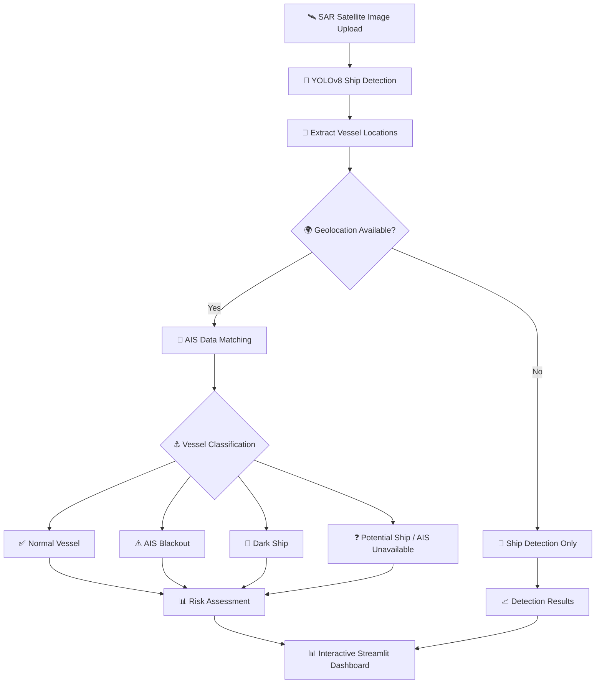

# 🚢 Dark Ship Detection System
### AI-Powered Maritime Surveillance Using YOLOv8, AIS Analysis & Geospatial Intelligence

An AI-powered maritime surveillance system that detects ships in Synthetic Aperture Radar (SAR) imagery, analyzes vessel activity using Automatic Identification System (AIS) data, and assesses potential maritime risks through an interactive Streamlit dashboard.

The system combines computer vision, AIS matching, geospatial analysis, and risk assessment to help identify potentially suspicious maritime activity.

---

## 📌 Table of Contents

- [Overview](#-overview)
- [Key Features](#-key-features)
- [System Architecture](#️-system-architecture)
- [Vessel Classification](#-vessel-classification)
- [Technology Stack](#️-technology-stack)
- [Project Structure](#-project-structure)
- [Installation](#-installation)
- [Running the Application](#-running-the-application)
- [How It Works](#-how-it-works)
- [Risk Assessment](#-risk-assessment)
- [Future Enhancements](#-future-enhancements)
- [Disclaimer](#️-disclaimer)

---

## 🌊 Overview

Ships may sometimes operate without transmitting AIS signals, making it difficult to monitor their movements using AIS data alone.

This project addresses this challenge by combining YOLOv8-based ship detection with AIS matching and geospatial analysis.

Users can upload SAR imagery through the dashboard. The system detects vessels, checks whether geographic information is available, performs AIS matching when suitable spatial and temporal information is available, and presents vessel classifications and risk scores.

When geolocation information is unavailable, the system can still perform ship detection, but reliable geographic AIS matching cannot be performed from the image alone.

---

## ✨ Key Features

- 🚢 **AI-Based Ship Detection:** Detect ships in SAR imagery using a YOLOv8 model.
- 🛰️ **SAR Image Processing:** Process satellite imagery for vessel detection.
- 🌍 **Geospatial Analysis:** Extract geographic information from supported georeferenced imagery and metadata.
- 📡 **AIS Matching:** Compare vessel detections with available AIS records using spatial and temporal criteria.
- 🔍 **Vessel Classification:** Classify detections into four vessel-status categories.
- ⚠️ **Risk Assessment:** Calculate risk scores using the system's configured rules.
- 📊 **Interactive Dashboard:** Visualize detection results, vessel statuses, and risk information using Streamlit.
- 🐳 **Docker Support:** Support containerized application deployment.

---

## 🏗️ System Architecture

The following diagram illustrates the end-to-end workflow of the Dark Ship Detection System.



### 🧩 Architecture Components

| Component | Description |
|---|---|
| 🛰️ SAR Image Input | Accepts satellite imagery uploaded by the user. |
| 🤖 YOLOv8 Detector | Identifies ships and their bounding boxes. |
| 🌍 Geolocation Module | Determines geographic coordinates from supported metadata. |
| 📡 AIS Matching Module | Matches vessel detections with AIS records using spatial and temporal criteria. |
| 🚢 Vessel Classification | Assigns vessel statuses according to the implemented classification logic. |
| ⚠️ Risk Assessment | Calculates risk scores using configured rules. |
| 📊 Streamlit Dashboard | Displays vessel detections, classifications, and risk information. |

---

## 🚢 Vessel Classification

The system uses four vessel classifications to represent the outcomes of ship detection and AIS analysis.

### 1. Normal Vessel 🟢

A detected vessel with a corresponding AIS record that satisfies the configured matching criteria.

### 2. AIS Blackout 🟠

A vessel associated with an AIS blackout or interruption indication, where supporting AIS information is available.

### 3. Dark Ship 🔴

A detected vessel classified as a potential dark ship because no suitable AIS match is found under the configured matching criteria.

A missing AIS match alone does not prove illegal activity. Classification depends on data availability, geolocation, and the configured matching criteria.

### 4. Potential Ship ⚪

A vessel detected in an image when reliable geographic AIS matching cannot be performed, such as when the required geolocation information is unavailable.

These classifications represent the application's analytical outputs and should not be interpreted as definitive proof of suspicious or illegal activity.

---

## 🛠️ Technology Stack

| Technology | Purpose |
|---|---|
| Python | Core application development |
| YOLOv8 | Ship detection |
| PyTorch | Deep learning model execution |
| OpenCV | Image processing |
| NumPy | Numerical operations |
| Pandas | AIS data handling and analysis |
| Streamlit | Interactive web dashboard |
| Geospatial Libraries | Geographic processing where configured |
| Docker | Application containerization |
| Git & GitHub | Version control and collaboration |

---

## 📁 Project Structure

```text
DarkShipProject/
│
├── app.py
│
├── src/
│   ├── pipeline.py
│   ├── ais_match.py
│   └── ais_simulator.py
│
├── models/
│   └── best_balanced_model.pt
│
├── data/
│   └── ais/
│
├── notebooks/
│
├── runs/
│   └── detect/
│
├── Dockerfile
├── .dockerignore
├── .gitignore
├── requirements.txt
├── scene_ids.txt
├── visualize_test_images.py
├── LICENSE
└── README.md
```

*Note: This is an illustrative structure. The actual files and directories may differ depending on the version of the project.*

---

## ⚙️ Installation

### Prerequisites

- Python 3.10 or a compatible version supported by the project dependencies
- Git
- pip
- Docker (optional)

### Step 1: Clone the Repository

```bash
git clone https://github.com/Abhinandan-Hooli/dark-ship-detection.git
cd dark-ship-detection
```

### Step 2: Create a Virtual Environment

**Windows**

```bash
python -m venv venv
venv\Scripts\activate
```

**Linux / macOS**

```bash
python3 -m venv venv
source venv/bin/activate
```

### Step 3: Install Dependencies

```bash
pip install -r requirements.txt
```

### Step 4: Verify the Model

Ensure the trained YOLOv8 model is available at the path expected by the application:

```text
models/best_balanced_model.pt
```

If the model file is not included in the repository, obtain it separately and place it at the expected location.

---

## 🚀 Running the Application

Start the Streamlit dashboard:

```bash
streamlit run app.py
```

Open the local URL displayed in your terminal. The default Streamlit address is usually:

```text
http://localhost:8501
```

### Running with Docker

Build the Docker image:

```bash
docker build -t dark-ship-detection .
```

Run the container:

```bash
docker run --rm -p 8501:8501 dark-ship-detection
```

Open the application at:

```text
http://localhost:8501
```

*Docker commands assume the Dockerfile and application configuration are correctly set up for the project.*

---

## 🔄 How It Works

### Step 1: SAR Image Upload
The user uploads a SAR image through the Streamlit dashboard.

### Step 2: Ship Detection
The YOLOv8 model processes the image and identifies potential vessels using bounding boxes.

### Step 3: Geolocation
The pipeline checks whether supported georeferencing information or metadata is available to associate detections with geographic coordinates.

### Step 4: AIS Matching
When sufficient spatial and temporal information is available, the system compares detected vessels with AIS records.

### Step 5: Vessel Classification
The system uses the matching results and available AIS information to assign a vessel classification.

### Step 6: Risk Assessment
The system calculates a risk score according to its configured rules.

### Step 7: Dashboard Visualization
The results are displayed through the Streamlit dashboard for inspection and analysis.

---

## 📊 Risk Assessment

The system uses a rule-based approach to calculate risk scores from vessel classification and matching information.

Risk assessment helps prioritize detections for further review. Scores should be interpreted alongside the underlying detection, AIS availability, geolocation accuracy, and matching criteria.

A risk score is an analytical indicator, not proof of illegal activity.

---

## 🔮 Future Enhancements

- Integrate reliable real-world AIS data sources.
- Improve geolocation support for georeferenced Sentinel-1 imagery.
- Enhance spatial and temporal vessel matching.
- Add historical vessel tracking and movement analysis.
- Improve dashboard visualizations and reporting.
- Evaluate detection and classification performance using independently verified data.
- Improve container deployment and reproducibility.

---

## ⚠️ Disclaimer

This project is intended for educational, research, and maritime-monitoring purposes.

Vessel classifications and risk scores are algorithmic estimates. They should not be treated as conclusive evidence of illegal activity. Results depend on image quality, geolocation accuracy, AIS availability, matching criteria, and model performance.

Satellite imagery, AIS datasets, and pretrained model weights may be subject to separate licensing and usage restrictions.

---

## 👨‍💻 Author

**Abhinandan Hooli**

GitHub: [@Abhinandan-Hooli](https://github.com/Abhinandan-Hooli)

**Project:** Dark Ship Detection System

---

⭐ If you find this project interesting, consider starring the repository!
